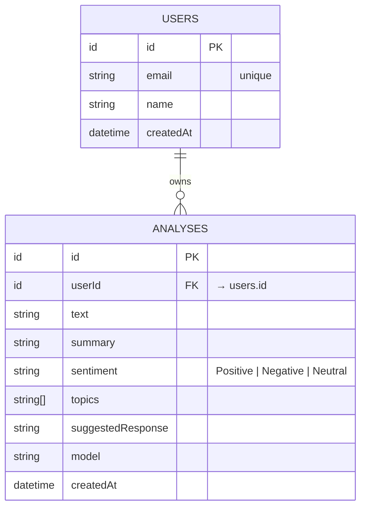
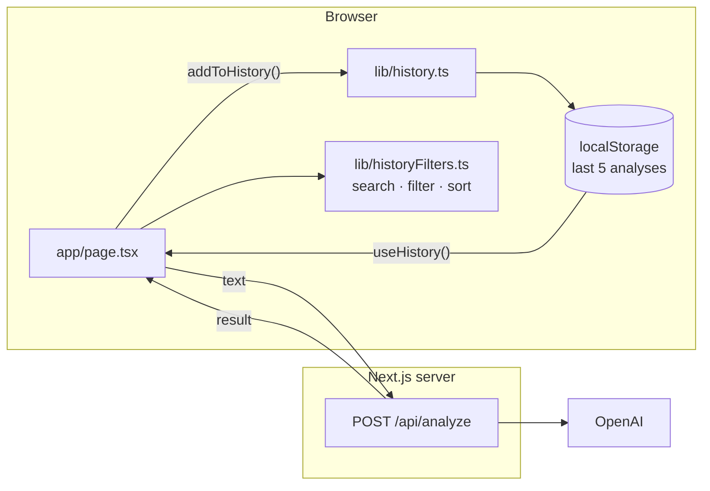
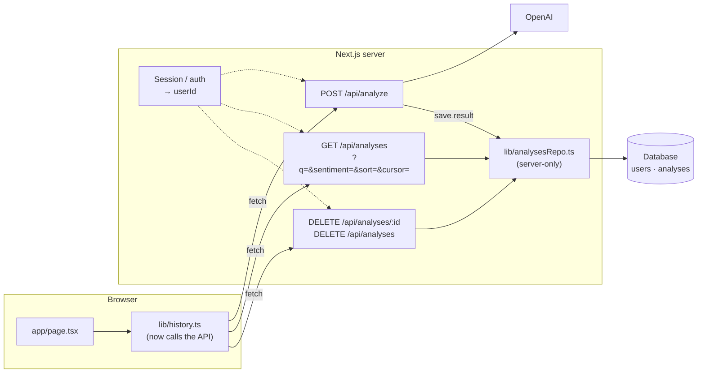

# Database Design: AI Text Analyzer

How the AI Text Analyzer's data should be structured and stored when we move from the browser's localStorage to a real database.

> **Status: design only.** Nothing in this document is implemented yet. The app still uses localStorage and has no database and no user accounts. It is the plan for the next development stage, before we choose between MongoDB, Firebase and Supabase.

**Contents:** [1. Understanding the data](#1-understanding-the-data) · [2. Users and analyses](#2-users-and-analyses) · [3. Database structure](#3-database-structure) · [4. Data operations](#4-data-operations) · [5. Future architecture](#5-future-architecture) · [6. Decisions and open questions](#6-decisions-and-open-questions)

---

## Where we are today

Each successful analysis is saved in the browser by `lib/history.ts`, under one localStorage key (`ai-text-analyzer:history`). It's stored as a JSON array, newest first, with at most 5 items. One saved item looks like this today:

```json
{
  "id": "1764151500000-k3j9x2",
  "text": "My package arrived two weeks late and the screen was cracked…",
  "result": {
    "summary": "The customer received a late, damaged package and wants a refund.",
    "sentiment": "Negative",
    "topics": ["Late Delivery", "Damaged Product", "Refund Request"],
    "suggestedResponse": "I'm very sorry your order arrived late and damaged…"
  },
  "analyzedAt": "2026-11-26T14:05:00.000Z"
}
```

The shape comes from two TypeScript types: `HistoryItem` in `lib/history.ts` and `AnalysisResult` in `lib/types.ts`. Search, the sentiment filter and sorting are done in the browser by `filterAndSortHistory()` in `lib/historyFilters.ts`.

**What localStorage can't do**, and why we need a database:

| localStorage today | What a database adds |
|---|---|
| Lives in one browser on one device | The same history on every device and browser |
| Lost if the user clears site data | Stored safely on a server, with backups |
| No idea who the user is | Each analysis belongs to a user account |
| Limited to about 5 MB, so we keep only 5 items | Thousands of analyses per user, loaded a page at a time |
| Search runs over the 5 items in the browser | Search and filtering run in the database, using indexes |
| Anyone using the same browser profile can read it | Access is checked on the server for every request |

---

## 1. Understanding the data

### What does the app need to save?

Two kinds of things:

1. **Analyses**: one record for each successful analysis. This is the data we already save today.
2. **Users**: who each analysis belongs to. Users don't exist yet. They arrive with authentication.

Two things are **not** saved:

- **Failed analyses.** An error message is not a result, and the app doesn't save failures today either.
- **Search, filter and sort choices.** These are view settings in the browser (`RecentAnalyses.tsx`). They decide what's *shown*, not what's *stored*.

### What should each analysis contain?

Everything needed to **show it again without calling OpenAI**. That means the original input, all four AI outputs, and when it happened. That's exactly what "open a saved analysis" does today. Add the owner, and the model that produced it.

### Fields of an analysis record

| Field | Type | Required | Where it comes from | Why we need it |
|---|---|---|---|---|
| `id` | ID generated by the database | yes | The database, on insert | Uniquely identifies the record. Used for open and delete. |
| `userId` | ID (a reference to `users`) | yes | The signed-in user's session, **on the server** | Says whose analysis this is |
| `text` | string, 1–5,000 characters | yes | The request body (already validated by the route) | Shown in the list, put back in the text box, and searched |
| `summary` | string | yes | AI result | Shown, and searched |
| `sentiment` | `"Positive"`, `"Negative"` or `"Neutral"` | yes | AI result | Shown as a badge, and filtered on |
| `topics` | list of strings (at most 5) | yes | AI result | Shown as pills |
| `suggestedResponse` | string | yes | AI result | Shown in the reply card |
| `model` | string, e.g. `"gpt-5.5"` or `"mock"` | yes | `OPENAI_MODEL`, or `"mock"` when no key is set | Shows which model produced a result, which matters when we change models |
| `createdAt` | date and time (UTC) | yes | The **server** clock at insert time | Sorting, and the date shown in the list (`analyzedAt` today) |

Notes on the choices:

- **No `updatedAt`.** An analysis never changes after it's created. It can only be deleted.
- **`createdAt` is set by the server, not the browser.** A user's computer clock can be wrong, and a client could send any date it likes.
- **The AI result fields are stored as they are.** We don't re-run the AI to rebuild them. That's what makes opening a saved analysis free.
- **Fields we deliberately leave out for now:** token usage and cost, the language, the IP address. Each can be added later if needed. We don't collect more personal data than the feature uses.

### Users

Until authentication is built, all we need from a user is a stable id that each analysis can point to. The auth provider will own the details (password, sign-in methods).

| Field | Type | Why |
|---|---|---|
| `id` | ID | Uniquely identifies the user. Analyses point to it. |
| `email` | string, unique | Sign-in and contact |
| `name` | string, optional | Display only |
| `createdAt` | date and time | When the account was created |

### What uniquely identifies an analysis?

**A database-generated id, and never the content.**

- The **text** can't identify an analysis. Two users can analyze the same text, and one user can analyze the same text twice.
- The **date and time** can't either. Two analyses can be saved in the same millisecond.
- The id we create in the browser today (`Date.now()` plus 6 random characters) is fine for 5 items in one browser. In a shared database, the **database's own id** is safer: a MongoDB `ObjectId`, or a `uuid` in Postgres. It's guaranteed to be unique.

**About duplicates.** Today, `addToHistory()` replaces an older entry with the same text instead of adding a second copy. With a database, there are two options:

- **Keep every analysis (recommended).** It's simpler, and a re-run can give a different answer, which is worth keeping.
- **Keep one per text.** Enforce it with a unique index on `(userId, textHash)`, where `textHash` is a SHA-256 of the text. That's shorter than indexing 5,000 characters.

This is listed as an open question in [section 6](#6-decisions-and-open-questions).

---

## 2. Users and analyses

### The relationship: one-to-many

**One user has many analyses. Each analysis belongs to exactly one user.**



`||--o{` means "exactly one user owns zero or more analyses". A new user has no analyses. A long-time user might have hundreds.

### How do we connect them?

We store the owner's id **on each analysis** (`userId`). This is called a **reference**, or a **foreign key** in SQL.

We do **not** store a list of analyses inside the user record. A user's history keeps growing, and a user record that grows forever gets slow to read and write. MongoDB also caps a single document at 16 MB. Keeping analyses as separate records means each one can be created, read and deleted on its own.

### How do we get only one user's analyses?

**Filter every query by `userId`, and take the `userId` from the signed-in session on the server.** Never take it from the browser.

```text
"Give me analyses WHERE userId = <the signed-in user's id>, newest first"
```

That one rule is what keeps users' data apart:

- A request like `GET /api/analyses?userId=123` would let anyone read anyone's history by changing the number. Instead, the server works out who is asking from the login session, and adds that `userId` itself.
- Delete works the same way: delete the analysis where `id = X` **and** `userId = me`. Then nobody can delete another user's analysis by guessing its id.

To keep this fast, we add an index on `(userId, createdAt)`. It works like a book's index sorted by user, then by date. The database jumps straight to one user's analyses, already in date order, instead of scanning every row.

---

## 3. Database structure

The same data can be modelled in two ways:

- A **document database** (MongoDB, or Firebase's Firestore)
- A **relational database** (PostgreSQL, which is what Supabase runs on)

### Option A: MongoDB (documents in collections)

There are two collections: `users` and `analyses`. One analysis document looks very much like today's `HistoryItem`. It's JSON-like, the topics are a plain array, and the AI result fields sit inside it.

```js
// Collection: users
{
  _id: ObjectId("6745f0c2a1b2c3d4e5f60001"),
  email: "sam@example.com",
  name: "Sam",
  createdAt: ISODate("2026-11-20T09:00:00Z")
}

// Collection: analyses
{
  _id: ObjectId("6745f1d9a1b2c3d4e5f60042"),
  userId: ObjectId("6745f0c2a1b2c3d4e5f60001"),   // reference to users._id
  text: "My package arrived two weeks late and the screen was cracked…",
  result: {                                          // same shape as AnalysisResult
    summary: "The customer received a late, damaged package and wants a refund.",
    sentiment: "Negative",
    topics: ["Late Delivery", "Damaged Product", "Refund Request"],
    suggestedResponse: "I'm very sorry your order arrived late and damaged…"
  },
  model: "gpt-5.5",
  createdAt: ISODate("2026-11-26T14:05:00Z")
}
```

Indexes:

```js
db.analyses.createIndex({ userId: 1, createdAt: -1 });   // "my analyses, newest first"; also used for oldest first
db.analyses.createIndex({ userId: 1, "result.sentiment": 1, createdAt: -1 }); // "my Negative analyses, by date"
db.users.createIndex({ email: 1 }, { unique: true });
```

Why this shape:

- **The AI result is embedded** (nested inside the analysis). It's always read together with the analysis and never on its own, so storing it together means one read.
- **The user is referenced** by `userId`, not embedded, for the reasons in [section 2](#2-users-and-analyses).
- MongoDB doesn't force every document to have the same fields. So we would still validate the shape in our code (we already use Zod), or add a MongoDB `$jsonSchema` validator. Otherwise a bug could save a document without, say, a `sentiment`.

**Firebase (Firestore)** is also a document database, so the model is almost the same. The usual layout puts analyses under each user: `users/{userId}/analyses/{analysisId}`. The path itself then says who owns each analysis, and Firestore security rules can check `request.auth.uid == userId`.

### Option B: relational tables (PostgreSQL, which Supabase uses)

The same data goes into tables with fixed columns:

```sql
CREATE TABLE users (
  id          uuid PRIMARY KEY DEFAULT gen_random_uuid(),
  email       text NOT NULL UNIQUE,
  name        text,
  created_at  timestamptz NOT NULL DEFAULT now()
);

CREATE TABLE analyses (
  id                  uuid PRIMARY KEY DEFAULT gen_random_uuid(),
  user_id             uuid NOT NULL REFERENCES users(id) ON DELETE CASCADE,
  text                text NOT NULL CHECK (char_length(text) BETWEEN 1 AND 5000),
  summary             text NOT NULL,
  sentiment           text NOT NULL CHECK (sentiment IN ('Positive', 'Negative', 'Neutral')),
  topics              text[] NOT NULL,       -- a Postgres array: {"Late Delivery","Refund Request"}
  suggested_response  text NOT NULL,
  model               text NOT NULL,
  created_at          timestamptz NOT NULL DEFAULT now()
);

CREATE INDEX analyses_user_created_idx ON analyses (user_id, created_at DESC);
```

| `id` | `user_id` | `text` | `summary` | `sentiment` | `topics` | `suggested_response` | `model` | `created_at` |
|---|---|---|---|---|---|---|---|---|
| `9f1c…` | `3a7e…` | My package arrived two weeks late… | The customer received a late… | Negative | {Late Delivery, Damaged Product, Refund Request} | I'm very sorry… | gpt-5.5 | 2026-11-26 14:05:00+00 |

Why this shape:

- **`REFERENCES users(id)`** is the foreign key. The database refuses an analysis whose user doesn't exist.
- **`ON DELETE CASCADE`**: if a user account is deleted, their analyses are deleted with it, so no orphaned rows are left.
- **`CHECK` constraints** enforce the same rules as our TypeScript types and the route's validation, this time inside the database: only three sentiments, and 1–5,000 characters.
- **The result fields are flattened into columns** (`summary`, `sentiment`, …) instead of nested. Each one can then have its own type, constraint and index.
- **Topics as a `text[]` array** keeps it simple, because topics are only displayed, never queried on their own. The strictly normalized alternative is a separate table, `analysis_topics (analysis_id, position, topic)`. We would only need that if we wanted queries like "all analyses tagged *Refund Request*" across many rows. It's not needed now.
- **Supabase Row Level Security** can add a second guard inside the database: `CREATE POLICY ... USING (user_id = auth.uid())`. Even a buggy query then can't return another user's rows.

### Collection and document vs table and row

| | Document database (MongoDB, Firestore) | Relational database (Postgres, Supabase) |
|---|---|---|
| A group of records | **Collection** (`analyses`) | **Table** (`analyses`) |
| One record | **Document**: a JSON-like object | **Row**: one value per column |
| Structure | Flexible. Documents in one collection *can* have different fields. Our code enforces the shape. | Fixed. Columns and types are declared up front, and the database enforces them. |
| Nested data | Natural. `result: { summary, … }` and `topics: [...]` live inside the document. | Flat columns. Lists use an array column or a separate table. |
| Connecting records | Store the other record's id (a reference), or embed it | A foreign key, combined at query time with `JOIN` |
| Changing the shape | Just start saving the new field. Old documents simply don't have it. | A **migration** (`ALTER TABLE …`) |
| Query language | MongoDB query objects (`find({ … })`) | SQL (`SELECT … WHERE …`) |
| Suits our data because | An analysis is already one self-contained JSON object (`HistoryItem`) | The data is very regular and has a clear one-to-many relationship |

**For this app, either works.** Every analysis has the same fields, users and analyses are a simple one-to-many relationship, and there are no complicated joins. The deciding factors will be practical: auth that's built in (Supabase and Firebase have it), hosting, cost, and what the team wants to learn.

---

## 4. Data operations

Each operation the app already does in localStorage (`lib/history.ts`) maps to one database operation. In every query, `me` means the user id **taken from the session on the server**.

| Operation | Today: localStorage (`lib/history.ts`) | MongoDB | SQL (Postgres or Supabase) |
|---|---|---|---|
| **Create** a new analysis | `addToHistory(text, result)` puts it first and keeps 5 | `insertOne({ userId: me, text, result, model, createdAt: new Date() })` | `INSERT INTO analyses (user_id, text, summary, sentiment, topics, suggested_response, model) VALUES ($1, …) RETURNING *` |
| **Retrieve** previous analyses | `useHistory()` reads and parses the whole key | `find({ userId: me }).sort({ createdAt: -1 }).limit(20)` | `SELECT * FROM analyses WHERE user_id = $1 ORDER BY created_at DESC LIMIT 20` |
| **Search** text or summary | `filterAndSortHistory()` checks `includes()`, case-insensitive | `find({ userId: me, $or: [{ text: /refund/i }, { "result.summary": /refund/i }] })` | `… WHERE user_id = $1 AND (text ILIKE $2 OR summary ILIKE $2)`, with `$2 = '%refund%'` |
| **Filter** by sentiment | Same function, `sentiment === "Negative"` | add `"result.sentiment": "Negative"` to the query | add `AND sentiment = $3` |
| **Sort** by date | Same function, sorts a copy by `analyzedAt` | `.sort({ createdAt: -1 })` for newest, `1` for oldest | `ORDER BY created_at DESC` or `ASC` |
| **Delete** one analysis | `deleteFromHistory(id)` | `deleteOne({ _id: id, userId: me })` | `DELETE FROM analyses WHERE id = $1 AND user_id = $2` |
| **Clear** a user's history | `clearHistory()` removes the key | `deleteMany({ userId: me })` | `DELETE FROM analyses WHERE user_id = $1` |

### Search, filter and sort together

All three combine into **one query**, just as they combine in `filterAndSortHistory()` today:

```js
// MongoDB: "my analyses mentioning 'refund', Negative only, oldest first"
db.analyses.find({
  userId: me,
  "result.sentiment": "Negative",
  $or: [{ text: /refund/i }, { "result.summary": /refund/i }],
}).sort({ createdAt: 1 }).limit(20);
```

```sql
-- SQL: the same question
SELECT id, text, summary, sentiment, topics, suggested_response, created_at
FROM analyses
WHERE user_id = $1
  AND sentiment = $2                            -- 'Negative'; this line is left out for "All"
  AND (text ILIKE $3 OR summary ILIKE $3)       -- '%refund%'; left out when the search box is empty
ORDER BY created_at ASC
LIMIT 20;
```

Important details:

- **Always use parameters** (`$1`, `$2`) or the driver's query objects, and never paste the search text into the query string. Pasting user text into a query makes it vulnerable to **injection**: a search for `'; DROP TABLE analyses; --` must stay a harmless search. For MongoDB regex, also escape special characters such as `.` and `*` in the search text.
- **Delete and clear always include `userId`.** It's the difference between "delete my analysis" and "delete any analysis whose id you can guess".
- **Paging instead of "keep only 5".** The 5-item limit exists today because of localStorage. With a database we keep everything, and load 20 at a time with a "Load more" button. For paging by date, "give me the 20 older than the last one I have" (`createdAt < lastSeen`) is faster than "skip 40".
- **Search in the database, not the browser.** Today the browser filters 5 items, which is instant. With hundreds of analyses, we send the search, filter and sort choices to the server, and the database returns just the matching page. `ILIKE '%word%'` and a case-insensitive regex are fine for a personal history. For larger data, the better tool is a text index: MongoDB `$text` or Atlas Search, or Postgres full-text search with a `tsvector` column.

---

## 5. Future architecture

### Today: everything lives in the browser



### Later: the server owns the history



### The API

| Endpoint | What it does | Replaces |
|---|---|---|
| `POST /api/analyze` | **Unchanged for the browser.** After a successful AI call, the server also saves the analysis with the session's `userId`, and returns the saved record including its `id`. | `addToHistory()` |
| `GET /api/analyses?q=&sentiment=&sort=&cursor=` | One page of *my* analyses, already searched, filtered and sorted by the database | `useHistory()` and `filterAndSortHistory()` |
| `DELETE /api/analyses/:id` | Delete one of *my* analyses | `deleteFromHistory(id)` |
| `DELETE /api/analyses` | Clear *my* history | `clearHistory()` |

**Why the server saves the analysis inside `/api/analyze`, not the browser.** Today the browser saves the result after the AI answers. With a database, a separate "save" endpoint would accept *any* JSON. A user could then store a fake analysis that OpenAI never produced. When the server saves exactly what it got back from OpenAI, the history is trustworthy, and the browser makes one request instead of two.

### Step by step: how we'd switch over

The current code was split up so this change stays small:

1. **Add a server-only data layer**, `lib/analysesRepo.ts`, with five functions: `createAnalysis`, `listAnalyses`, `deleteAnalysis`, `clearAnalyses` and `getAnalysis`. This is the only file that talks to the database. Switching between MongoDB and Supabase later then means changing this one file. It works the same way `lib/analyzer.ts` is the only file that talks to OpenAI.
2. **Add authentication**, so every request has a trusted `userId`.
3. **Add the routes in the table above.** They validate input as `/api/analyze` already does, and always pass the session's `userId` to the data layer.
4. **Change `lib/history.ts` to call the API instead of localStorage.** Its functions keep the same names, so `app/page.tsx` barely changes. `RecentAnalyses.tsx` doesn't change at all, because it only receives `items` and reports clicks. It never knew where the data came from.
5. **Move search, filter and sort to the server.** The same three choices are sent as query parameters, and the database does the work that `filterAndSortHistory()` does today. Add a short delay (about 300 ms) after typing, so we don't send a request on every keystroke.
6. **Optional one-time import.** On a user's first sign-in, offer to upload the up to 5 analyses still in their localStorage, then clear the key.
7. **Remove the 5-item limit** and add "Load more" paging.

### What stays the same

- The OpenAI integration in `lib/analyzer.ts`: same prompt, schema, model and error handling.
- The `AnalysisResult` type, the result cards, and the look of the Recent Analyses section.
- Opening a saved analysis still makes **no AI call**. It shows the stored result, now loaded from the database instead of localStorage.

### New things to handle

- **Loading and error states for history.** localStorage answers instantly and never fails. A network request can be slow or fail, so the history list needs a loading state and a "couldn't load history" message, like the analysis itself.
- **Privacy.** The text users analyze, such as emails and complaints, will be stored on our server. We need a clear statement of what is stored and for how long, a way to delete it (delete and clear already exist), and deletion of all data when an account is deleted (`ON DELETE CASCADE`, or `deleteMany` for MongoDB).
- **Secrets.** The database connection string goes in `.env.local` on the server only, with no `NEXT_PUBLIC_` prefix, exactly like `OPENAI_API_KEY`.

---

## 6. Decisions and open questions

### Decisions made in this design

| Decision | Reason |
|---|---|
| Two entities, `users` and `analyses`, in a one-to-many relationship | That's all the app needs. Nothing else is stored. |
| The analysis stores `userId`, and the user doesn't store a list of analyses | History grows without limit, and each analysis is created and deleted on its own |
| A database-generated id | Guaranteed unique. Text and time are not. |
| `createdAt` and `userId` are set by the server | The browser can't be trusted for identity or time |
| The server saves the analysis inside `/api/analyze` | Only real AI results get stored, and it takes one request instead of two |
| Every query is filtered by the session's `userId`, and indexed on `(userId, createdAt)` | Data isolation between users, and fast "my history, by date" |
| A data-layer module (`lib/analysesRepo.ts`) | Keeps the database choice in one file |

### Open questions for the team

1. **Duplicates:** keep every analysis, or one per text as today? We recommend keeping every analysis.
2. **Retention:** keep history forever, or delete analyses older than, say, 90 days?
3. **Limits:** a maximum number of stored analyses per user?
4. **Delete:** permanent (a hard delete), or recoverable for a while with a `deletedAt` field (a soft delete)? This design assumes permanent, which matches what users expect from "Delete".
5. **Which database:** MongoDB, Firebase (Firestore) or Supabase (Postgres)? This design works with all three, so the choice can rest on auth, hosting and cost.
